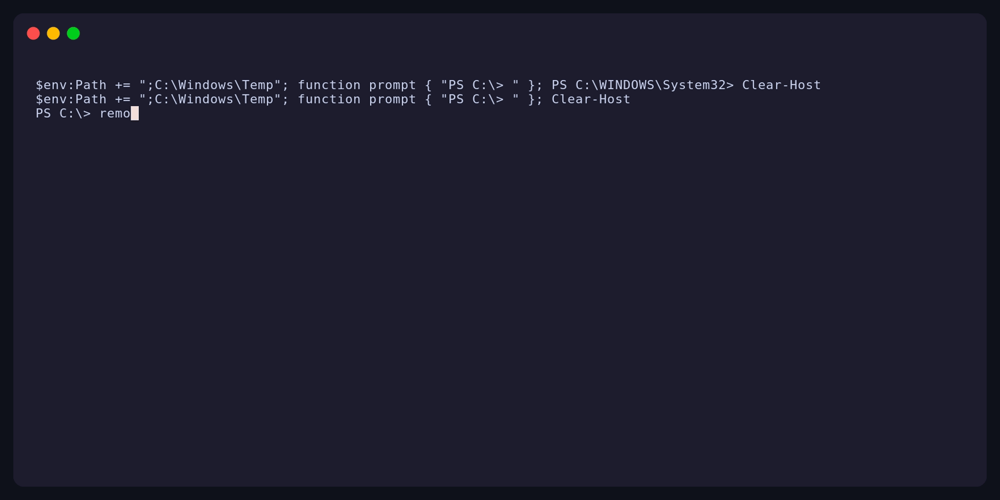

<div align="center">

# remoteexec

[](https://github.com/rubyattack3r/remoteexec/actions/workflows/ci.yml)
[](LICENSE)
[](https://goreportcard.com/report/github.com/rubyattack3r/remoteexec)

Cross-platform remote-execution assessment tooling for authorized red-team engagements.

</div>

> [!IMPORTANT]
> Use remoteexec only on systems you own or have explicit written permission to test. Use is governed by the [Acceptable Use Policy](ACCEPTABLE_USE_POLICY.md).

remoteexec wraps remote-execution primitives in a single CLI. Windows is the main focus today (WMI, WinRM, DCOM, Task Scheduler, and SCM), with Linux and macOS support starting over SSH. Every target is validated before anything runs, and results come back as JSON, YAML, or Signal.



## Dry-run only

The public build only supports `--dry-run`: it validates targets and prints a plan, but never stages or executes anything. On Windows, dry runs also perform live read-only checks (credentials, permissions, network reachability, service state).

## Quick Start

```bash
go build -o remoteexec .

# Inventory techniques and their detection profile.
./remoteexec exec techniques --output yaml

# Inventory supported loader selectors.
./remoteexec exec binaries --output json

# Validate a LOLBin-backed plan without changing the target.
./remoteexec exec technique --targets 10.0.0.15 --technique WMIExec \
  --payload-type dll --payload ./loader.dll --remote-path 'D:\Staging\loader.dll' \
  --lolbin rundll32.exe --entry-point ServiceMain \
  --domain CORP --username admin --password 'Passw0rd!' \
  --dry-run

# Validate an existing-service plan.
./remoteexec exec technique --targets 10.0.0.15 --technique SCMChangeService \
  --payload-type service --payload ./svc.exe \
  --remote-path 'C:\Windows\Temp\svc.exe' --service-name Spooler \
  --domain CORP --username admin \
  --password 'Passw0rd!' --dry-run

# Exercise the WMI execution primitive without staging a file.
./remoteexec exec technique --targets 10.0.0.15 --technique WMIExec \
  --payload-type command --command 'whoami.exe /all' \
  --domain CORP --username admin --password 'Passw0rd!' --dry-run

# Validate a PsExec-style temporary-service plan.
./remoteexec exec technique --targets 10.0.0.15 --technique SCMCreateService \
  --payload-type service --payload ./svc.exe \
  --remote-path 'C:\Windows\Temp\svc.exe' --service-name RemoteExecTmp \
  --domain CORP --username admin --password 'Passw0rd!' --dry-run
```

Avoid passing passwords directly on the command line. Use `--password-stdin` to keep them out of shell history.

See the [documentation index](docs/index.md), [LOLBins reference](docs/lolbins.md), [runtime configuration](docs/configuration.md), [architecture](docs/architecture.md), [output schema](docs/output.md), and [operator recovery guide](docs/recovery.md).

## Contributing

Read [CONTRIBUTING.md](CONTRIBUTING.md) and run `make lint test` before opening a PR. To re-record the demo GIF, run `make demo` (requires [VHS](https://github.com/charmbracelet/vhs)).

## Community

Open a GitHub issue for bugs and feature proposals. Report vulnerabilities privately as described in [SECURITY.md](SECURITY.md). Participation is subject to the [Code of Conduct](CODE_OF_CONDUCT.md).

## License

Copyright 2026 rubyattack3r. Licensed under the [Apache License 2.0](LICENSE).
