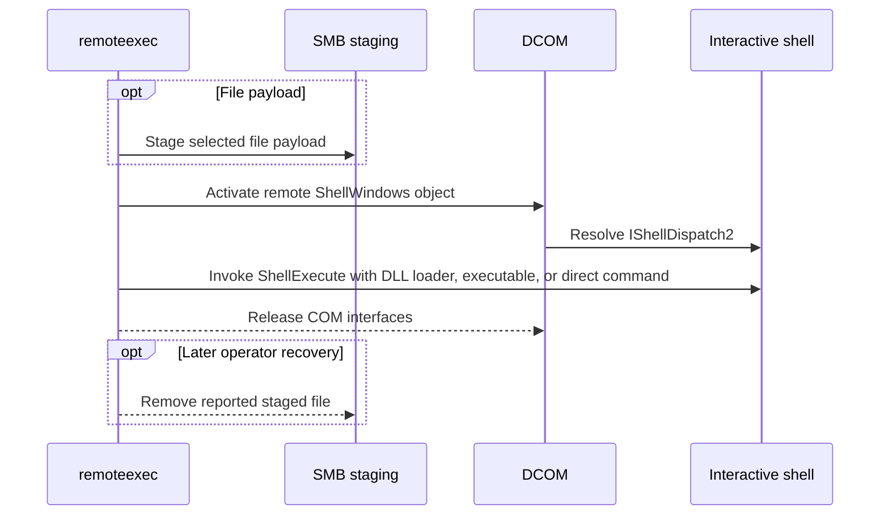

# DCOMIShellDispatch2

## Mechanism and prerequisites

Activates the remote Shell COM class and invokes `IShellDispatch2.ShellExecute`. It accepts launcher-backed native DLL, CPL, and managed payloads, a staged executable, or a direct `command` payload. It requires local-administrator rights, reachable DCOM, and an active interactive user shell on the target. Preflight verifies the shell condition before staging or execution.

An active Explorer session is necessary but is not sufficient on every Windows build. Preflight resolves the shell automation interface itself before any file is staged. A default Windows Server 2025 build 26100 image permitted remote activation but denied access to `IShellWindows.Item`, so preflight rejects that platform configuration without mutation. See [tested platforms](../platforms.md).

## Privilege and network surface

- Local administrator on the target
- An active interactive user logon with a shell
- DCOM via TCP 135 and negotiated dynamic RPC ports
- SMB on TCP 445 for file payloads

## Operator recovery

Remove the staged file after the launched process releases it when a file payload was selected. Command mode stages no file. See [operator recovery](../recovery.md).

## Detection considerations

Visibility depends heavily on whether DCOM activation telemetry is collected. Command mode avoids SMB, DLL-load, and LOLBAS signals, but DCOM activation, `ShellExecute`, and the resulting process remain detectable. The active-shell precondition still narrows usable targets.
