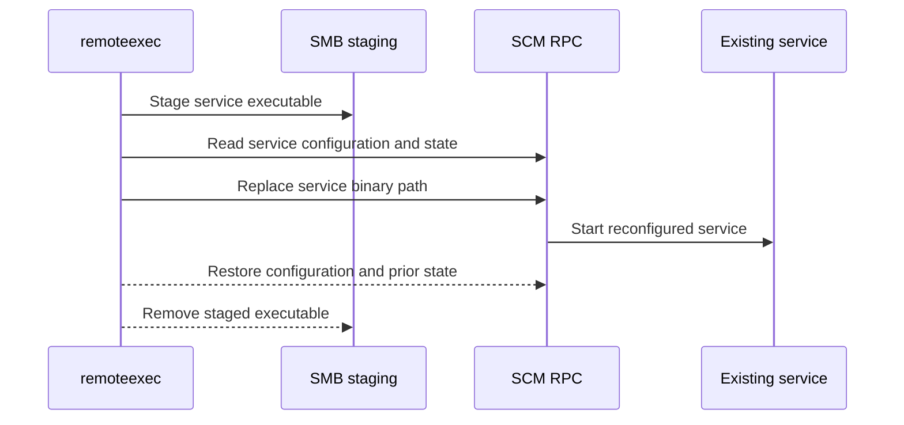

# SCMChangeService

## Mechanism and prerequisites

Uses Service Control Manager RPC to snapshot and temporarily replace an existing service's binary path, then starts that service. It requires local-administrator rights, reachable SCM RPC, an explicitly selected existing service, and readable original configuration. Preflight must prove restoration is possible before modification.

Payload support: `service` only. The file must implement the Windows service lifecycle expected by the selected existing service.

## Privilege and network surface

- Local administrator on the target
- SCM RPC, commonly over SMB on TCP 445
- RPC endpoint mapper on TCP 135 where required

## Operator recovery

Restore the complete original service configuration and running state, then remove the staged executable. See [operator recovery](../recovery.md).

## Detection considerations

Relative detectability: **high**. SCM configuration changes, service starts, and anomalous image paths are well-signatured. Selecting a service that is already noisy can change alert priority, but does not make the technique undetectable.
