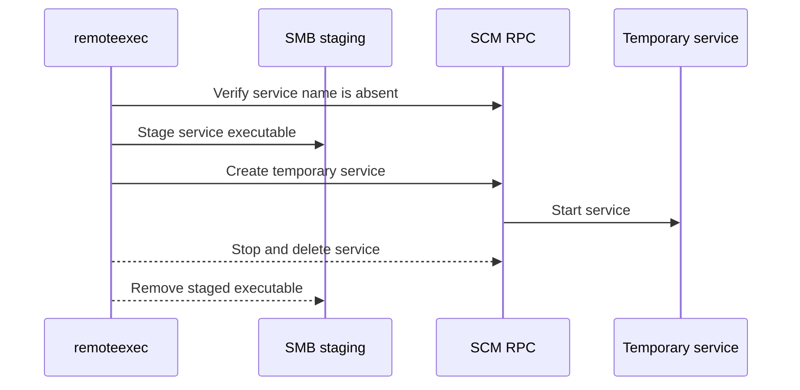

# SCMCreateService

## Mechanism and prerequisites

Implements a PsExec-style primitive natively: stage a Windows service executable, create and start a temporary service through SCM RPC, then remove both. It requires local-administrator rights, reachable SCM/SMB, and an unused `--service-name`. It does not bundle or invoke Microsoft's PsExec utility.

## Privilege and network surface

- Local administrator on the target
- SCM RPC over SMB TCP 445
- RPC endpoint mapper TCP 135 where required

## Operator recovery

Stop the exact service reported in the result if it is still running, delete it, verify its absence, and remove the digest-matched staged executable. See [operator recovery](../recovery.md).

## Detection considerations

Relative detectability: **high**. New-service installation, administrative-share writes, service start activity, and a short-lived service definition are well-signatured PsExec-style lateral-movement indicators. Custom naming does not make the technique undetectable.
