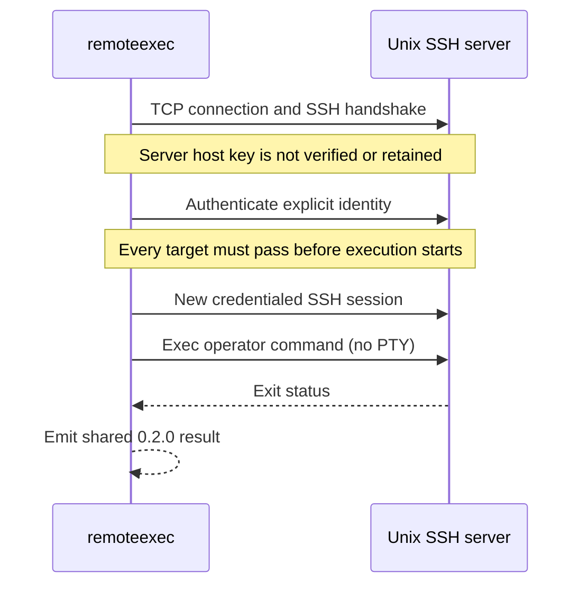

# SSH command execution

`SSHExec` is a deliberately narrow, platform-neutral command-execution primitive. Its protocol implementation targets SSH servers on Linux, macOS, and Windows by passing the supplied command to the server's default command processor. Linux and Windows OpenSSH have been validated live; macOS remains untested. Windows-specific WMI, DCOM, SCM, and Task Scheduler techniques remain remoteexec's primary focus.

## Quick start

```bash
remoteexec exec technique \
  --targets unix01.example.test \
  --technique SSHExec \
  --payload-type command \
  --command 'id' \
  --username operator \
  --password-stdin
```

For key authentication, replace `--password-stdin` with `--private-key ./operator_ed25519`. The current implementation accepts unencrypted private keys; encrypted-key and agent support are not yet exposed. Use `--ssh-port` for a nonstandard listener.

## Mechanism and preflight

Before any supplied command runs on any target, remoteexec completes the following preflight for every target:

1. Connect to the configured SSH port.
2. Complete the SSH handshake without validating or retaining the server host key.
3. Authenticate with the explicit password or private key.

Only after every target passes does execution begin. remoteexec opens a fresh authenticated session, sends one SSH exec request without allocating a PTY, discards remote stdout/stderr, and treats the remote exit status as the execution result.



## Contract

| Property | `SSHExec` |
|---|---|
| Implementation scope | Linux, macOS, and Windows OpenSSH; see [tested platforms](../platforms.md) for live-validation status |
| Payload type | `command` only |
| Required privilege | Valid SSH account; the command has only that account's privileges |
| Network surface | SSH TCP 22 by default, configurable with `--ssh-port` |
| Authentication | Password or unencrypted private key |
| Host-key policy | Not verified or retained |
| File delivery | Not supported |
| PTY | Not requested |
| Recovery | No remoteexec-managed persistent artifact; command-specific effects remain the operator's responsibility |

The result contains `execution` evidence whose `invocation_id` is `command:sha256:<hex>`. A successful SSH request reports `disposition: completed`, `exit_code: 0`, and `process_id_status: not_provided_by_api`. Raw command text and arguments are not retained. SSH does not return a portable remote PID for this request.

## Server identity boundary

`SSHExec` intentionally does not manage host-key trust. This keeps one-off and frequently rebuilt assessment infrastructure stateless, but it means remoteexec authenticates the operator to whichever SSH server answers at the target address. An attacker able to intercept or redirect that connection can impersonate the target, observe commands, and capture password authentication. Prefer key authentication and an independently protected network path when those risks matter.

## Detection considerations

SSH authentication and session events, exec requests, shell audit facilities, process telemetry, command-specific side effects, and network-flow records can all expose the activity. Key-based authentication may resemble ordinary administration more closely than password authentication in some estates, but it is not inherently quiet. A nonstandard port changes routing, not the protocol's endpoint or process evidence.

Because remoteexec discards command output, `SSHExec` is an execution primitive rather than an interactive shell or collection channel. File transfer, SFTP/SCP staging, encrypted private-key passphrases, agent authentication, and command-output capture are intentionally outside this first slice.

The command string is not translated between shells. Its syntax must match the SSH server's configured command processor, such as a POSIX shell, PowerShell, or `cmd.exe`.
