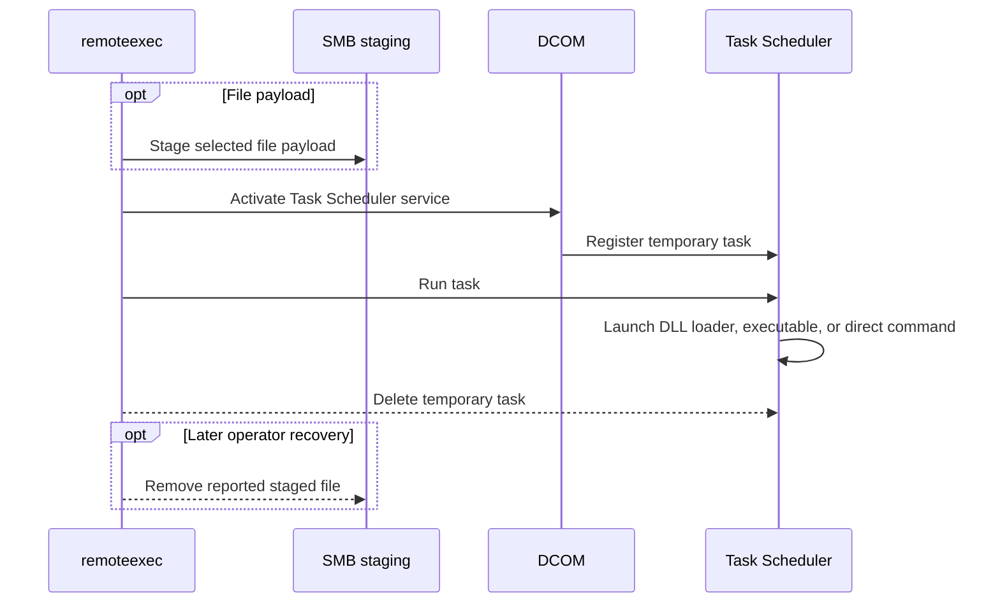

# TaskSchedExec

## Mechanism and prerequisites

Uses DCOM to reach the Task Scheduler service, register and run a temporary task, and then delete it. It accepts launcher-backed native DLL, CPL, and managed payloads, a staged executable, or a direct `command` payload. It requires local-administrator rights, reachable DCOM/RPC, and a functioning Task Scheduler service; file modes additionally require SMB.

## Privilege and network surface

- Local administrator on the target
- DCOM via TCP 135 and negotiated dynamic RPC ports
- SMB on TCP 445 for file payloads

## Operator recovery

Delete the exact task path reported in the result, release COM objects, and remove the staged file when present. Command mode still creates the temporary task. See [operator recovery](../recovery.md).

## Detection considerations

Relative detectability: **high**. Task registration and execution events, short-lived task definitions, RPC activity, and process creation are well-signatured. Command mode avoids SMB and DLL-loader signals but does not reduce the scheduled-task telemetry.
