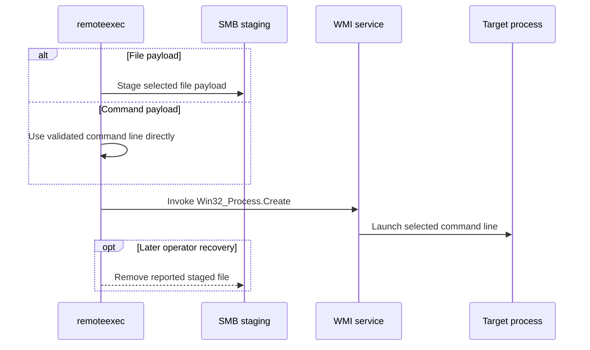

# WMIExec

## Mechanism and prerequisites

Calls `Win32_Process.Create` through WMI. It accepts launcher-backed native DLL, CPL, and managed payloads, a staged executable launched directly with `--arguments`, or a direct `command` payload with no file delivery. It requires local-administrator rights and reachable WMI/DCOM; file modes additionally require SMB.

## Privilege and network surface

- Local administrator on the target
- WMI/DCOM via TCP 135 and negotiated dynamic RPC ports
- SMB on TCP 445 for file payloads

## Operator recovery

For file payloads, remove the staged file after the process releases it. Command mode creates no persistent remoteexec file or configuration artifact. See [operator recovery](../recovery.md).

## Detection considerations

Remote WMI process creation is well-signatured. Command mode removes SMB staging, DLL image-load, and LOLBAS signals, but the WMI invocation and resulting command line remain detectable.
