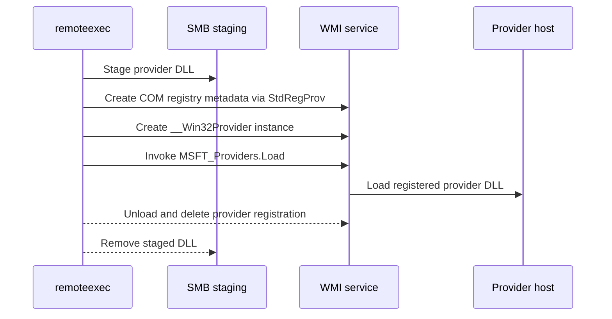

# WMIProvider

## Mechanism and prerequisites

Registers a temporary `__Win32Provider` definition and its COM registry metadata through WMI's `StdRegProv`, then invokes `MSFT_Providers.Load` for the new provider. It requires local-administrator rights, reachable WMI/DCOM, SMB delivery, and a DLL implementing the WMI provider interfaces. The Remote Registry service is not required.

Payload support: `dll` only. This mechanism cannot operate as a command-only primitive because WMI loads the registered in-process provider DLL.

## Privilege and network surface

- Local administrator on the target
- WMI/DCOM via TCP 135 and negotiated dynamic RPC ports
- SMB on TCP 445 for staging

## Operator recovery

Call `MSFT_Providers.UnLoad`, remove the exact provider instance and related registration keys reported in the result, then remove the staged DLL. Provider hosts can retain a DLL briefly after unload, so wait for release before removing it. See [operator recovery](../recovery.md).

## Detection considerations

Provider registration, registry writes through `StdRegProv`, WMI activity, and an unusual DLL load can be correlated. Provider naming and the selected hosting model affect alert confidence, but the technique is never undetectable.
