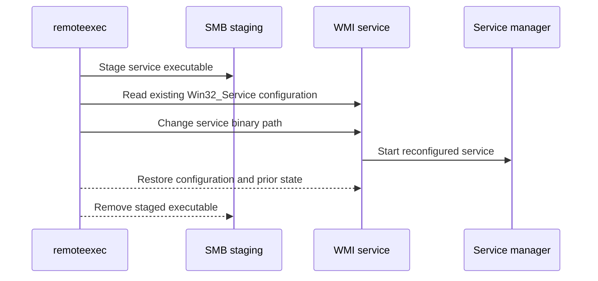

# WMIService

## Mechanism and prerequisites

Uses WMI `Win32_Service` methods to snapshot and temporarily reconfigure an existing service so it launches the staged service executable. It requires local-administrator rights, reachable WMI, an explicitly selected existing service, and readable original configuration. Preflight must prove the configuration can be restored before modification.

Payload support: `service` only. The file must implement the Windows service lifecycle expected by the selected existing service.

## Privilege and network surface

- Local administrator on the target
- WMI/DCOM via TCP 135 and negotiated dynamic RPC ports
- SMB on TCP 445

## Operator recovery

Restore the complete original service configuration and prior running state, then remove the staged executable. See [operator recovery](../recovery.md).

## Detection considerations

Relative detectability: **high**. Service configuration changes, unusual image paths, WMI administration, and service starts are well-signatured. Reusing a commonly modified service may change baseline rarity, but does not remove host telemetry.
