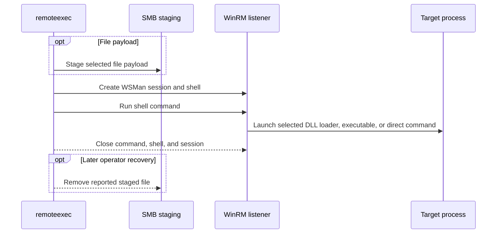

# WSManExec

## Mechanism and prerequisites

Creates a WSMan session, opens a shell, and executes a command with `WSManRunShellCommand`. It accepts launcher-backed native DLL, CPL, and managed payloads, a staged executable, or a direct `command` payload. It requires local-administrator rights and a reachable WinRM listener; file modes additionally require SMB. HTTP on TCP 5985 is the default; `--winrm-https` selects HTTPS on TCP 5986, and `--winrm-port` overrides the selected default.

## Privilege and network surface

- Local administrator accepted by the target's WinRM policy
- WinRM HTTP on TCP 5985 by default, or the configured HTTP/HTTPS port
- SMB on TCP 445 for file payloads

## Operator recovery

Remove the staged file after execution when a file payload was selected. Command mode stages no file. See [operator recovery](../recovery.md).

## Detection considerations

Relative detectability: **medium**. WinRM operational logs and process telemetry are mature. Command mode avoids SMB, DLL-load, and LOLBAS signals, but shell creation and the executed command remain detectable.
